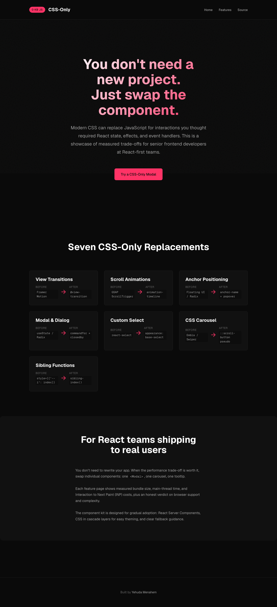

# CSS-Only Showcase

Built by Yehuda Menahem · [LinkedIn](https://www.linkedin.com/in/yehuda-menahem-49022330/)

Modern CSS replacing JavaScript in React components, with honest, measured trade-offs.

**Live:** [css-only-two.vercel.app](https://css-only-two.vercel.app)



## What it is

A showcase for React teams. Interactions that usually need state, effects, and event handlers are rebuilt with modern CSS and HTML, so a team can swap one component where the trade-off is worth it.

The components add zero JavaScript. Next.js still ships its own runtime. Each live page puts the JavaScript version beside the CSS version and records what was measured, including the limits of that measurement, plus browser support and complexity.

## What's live

- **[Modal & Dialog](https://css-only-two.vercel.app/features/invoker-commands)** — `commandfor` and `closedby`, replacing `useState` / Radix Dialog
- **[Anchor Positioning](https://css-only-two.vercel.app/features/anchor-positioning)** — `anchor-name` and `popover`, replacing Floating UI / Radix Tooltip
- **[Scroll Animations](https://css-only-two.vercel.app/features/scroll-animations)** — `animation-timeline`, replacing GSAP ScrollTrigger

View Transitions, Custom Select, CSS Carousel, and Sibling Functions are coming soon.

## Tech stack

- pnpm monorepo (`apps/site`, `packages/kit`)
- Next.js 16, React 19, TypeScript (strict)
- React Server Components
- CSS-only component kit
- Playwright
- GitHub Actions CI
- Vercel
- AI coding agents, working under [AGENTS.md](AGENTS.md)
- Technical decisions: [docs/DECISIONS.md](docs/DECISIONS.md)

## Run locally

Node.js 22 and pnpm 10.

```bash
pnpm install
pnpm dev
pnpm build
pnpm test
```

`pnpm dev` serves the site at [http://localhost:3000](http://localhost:3000). The first `pnpm test` needs Chromium: `pnpm --filter site exec playwright install chromium`.
